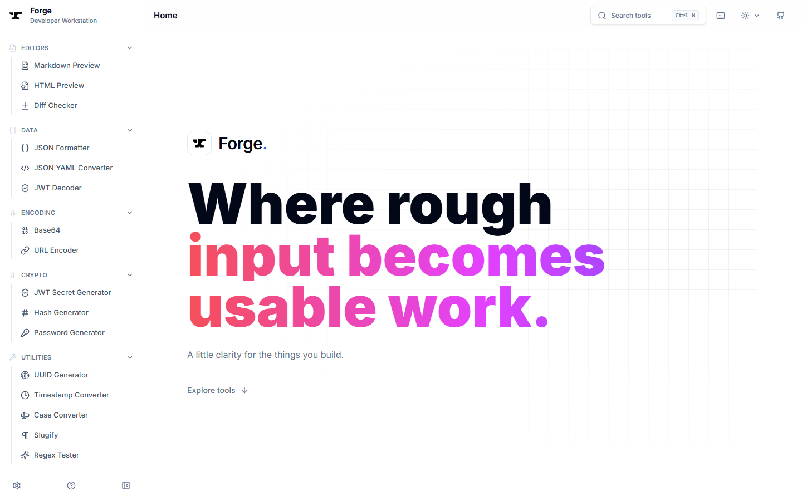

# Forge

**Where rough input becomes usable work.**

A local-first developer workstation for previewing documents, comparing text,
formatting data and inspecting tokens in one workspace. Built with React,
TypeScript and Vite. Open source under the MIT license.

[](https://github.com/cuthanhcam/forge/actions/workflows/ci.yml)
[](LICENSE)

[Open Forge](https://forge.cuthanhcam.workers.dev) ? [Start here](START-HERE.md) ?
[Documentation](docs/README.md) ? [Report an issue](https://forge.cuthanhcam.workers.dev/support/issue)



## A workspace for everyday development

- **Documents:** Markdown with Mermaid, math, outline navigation and local exports;
  sandboxed HTML preview; draggable, responsive editor panes.
- **Comparison:** split/unified diffs, numbered input editors, inline changes,
  whitespace controls and synchronized scrolling.
- **Focused utilities:** structure JSON/YAML, inspect JWT claims, encode values,
  generate passwords/secrets, test expressions and clean up text.
- **Consistent controls:** command search with Ctrl/Cmd+K, keyboard access,
  light/dark/system themes and remembered navigation preferences.

| Workflow  | Tools                                                                      |
| --------- | -------------------------------------------------------------------------- |
| Editors   | Markdown Preview, HTML Preview, Diff Checker                               |
| Data      | JSON Formatter, JSON YAML Converter, JWT Decoder                           |
| Encoding  | Base64, URL Encoder                                                        |
| Crypto    | JWT Secret Generator, Hash Generator, Password Generator                   |
| Utilities | UUID Generator, Timestamp Converter, Case Converter, Slugify, Regex Tester |

[Tool guide](docs/tools.md) ? [Directory screenshot](docs/assets/forge-directory.png)

## Run locally

Use Node.js **22+** and **pnpm 10.12.1** (pinned in `package.json`). No credentials
are needed to run the core tools.

```sh
git clone https://github.com/cuthanhcam/forge.git
cd forge
corepack enable
pnpm install --frozen-lockfile
pnpm dev
```

Open the URL printed by Vite. See [Start here](START-HERE.md) for the first
workflow, common setup problems and browser tests.

```sh
pnpm check:tools             # registry IDs, routes and loading layouts
pnpm check                   # types, lint, unit tests, production build
pnpm exec playwright install chromium
pnpm test:e2e                # desktop and phone browser interactions
```

CI runs the quality and Chromium browser gates. `develop` is the integration
branch; `main` receives reviewed release PRs. See [Contributing](CONTRIBUTING.md).

## Privacy and token boundaries

Core transformations run in the browser, without a Forge input-processing
backend. Some tools save drafts in browser storage; that storage is not an
encrypted vault or backup. Forge does not persist JWT tokens, verification
secrets or generated passwords/secrets.

JWT decoding does not authenticate a token. HMAC signature checking does not
replace your application's issuer, audience, time, revocation and authorization
checks. HTML and Markdown previews may load external resources; sandboxing and
sanitization do not prevent all network requests.

Read [Privacy](docs/privacy.md) and [Tokens, secrets and safe debugging](docs/security-and-tokens.md)
before using sensitive input. Use synthetic data for public reports. Report
vulnerabilities privately through [SECURITY.md](SECURITY.md).

## Project guide

| Need                | Start here                                                                              |
| ------------------- | --------------------------------------------------------------------------------------- |
| Learn the product   | [Tool guide](docs/tools.md), [workspace preferences](docs/workspace.md)                 |
| Make a change       | [Contributing](CONTRIBUTING.md), [architecture](docs/development/architecture.md)       |
| Review current work | [Changelog](CHANGELOG.md), [roadmap](docs/development/roadmap.md)                       |
| Deploy a copy       | [Deployment](docs/deployment.md)                                                        |
| Maintain a release  | [Maintainer guide](docs/development/maintaining.md)                                     |
| Get help            | [Support](docs/support.md), [issue tracker](https://github.com/cuthanhcam/forge/issues) |
| Join the community  | [Code of Conduct](CODE_OF_CONDUCT.md), [optional sponsorship](SPONSORING.md)            |

## Support the project

Contribute a focused fix, improve documentation, test accessibility or share a
redacted reproduction. Financial support is optional through
[GitHub Sponsors](https://github.com/sponsors/cuthanhcam) or
[Ko-fi](https://ko-fi.com/cuthanhcam). See [Sponsoring](SPONSORING.md).

## License

[MIT](LICENSE). Third-party dependencies retain their own licenses. No reference
project code is included merely by studying a local reference checkout.
